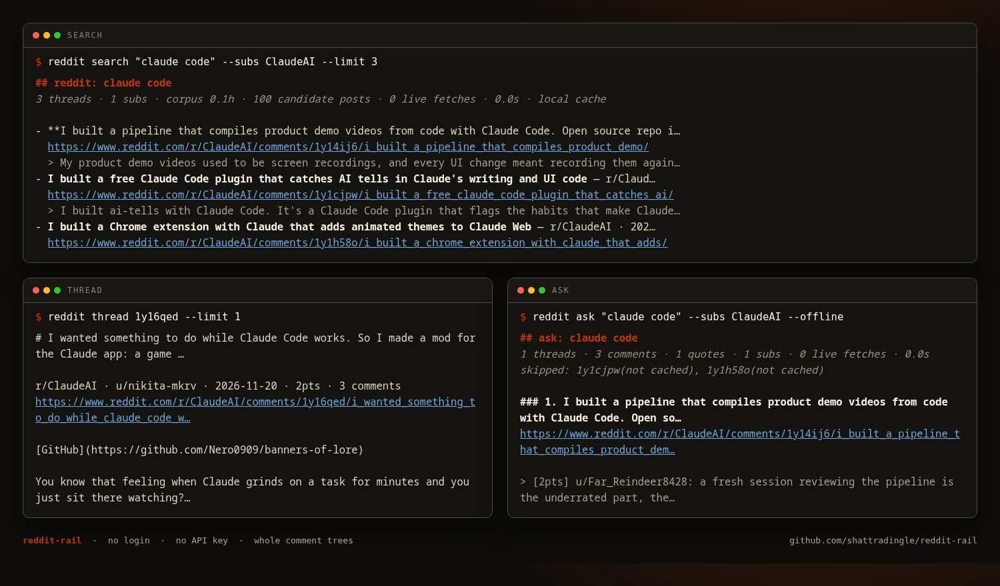

# reddit-rail

Search Reddit and read whole threads from the command line. **No login, no API key, no account, no per-request bill.** It is built for one job: putting real Reddit answers in front of you or your agent, with the link back to the source.

```console
$ reddit search "gap year engineering" --subs 6thForm,UniUK --limit 20
$ reddit ask "is a gap year worth it" --subs 6thForm,UniUK
$ reddit thread 1e5p300
```

| You have | You want | Go to |
| --- | --- | --- |
| an agent (Claude, Codex, Cursor, DSH) | Reddit as a tool | [MCP server](#mcp-server) |
| a terminal | answers with the source attached | [Quick start](#quick-start) |
| neither, just curiosity | see it working | [Demo](#demo) |

## Quick start

```console
$ uvx --from git+https://github.com/shattradingle/reddit-rail reddit --version
reddit-rail 2.0.0

$ uvx --from git+https://github.com/shattradingle/reddit-rail reddit search "claude code" --subs ClaudeAI --limit 3
```

```console
## reddit: claude code
_3 threads · 1 subs · corpus 0.0h · 100 candidate posts · 1 live fetches · 9.4s · arctic-shift(1ok/0fail)_

- **I built a pipeline that compiles product demo videos from code with Claude Code.** — r/ClaudeAI · 2026-11-20 · 1pts · 3c
  https://www.reddit.com/r/ClaudeAI/comments/1y14ij6/i_built_a_pipeline_that_compiles_product_demo/
  > My product demo videos used to be screen recordings, and every UI change meant recording them again. Now each video is a folder…

- **I built a free Claude Code plugin that catches AI tells in Claude's writing and UI code** — r/ClaudeAI · 2026-11-20 · 0pts · 1c
  https://www.reddit.com/r/ClaudeAI/comments/1y1cjpw/i_built_a_free_claude_code_plugin_that_catches_ai/
```

Without `uvx`, the package is stdlib-only and installs in place:

```console
$ git clone https://github.com/shattradingle/reddit-rail && cd reddit-rail
$ pip install .
$ reddit --help
```

## Demo



`search` gives you threads. `ask` opens the top ones and hands back the highest-scoring comments verbatim, each with its score and permalink, which is usually the part you actually wanted. Real output, run `--offline` against a corpus this machine had already fetched:

```console
$ reddit ask "claude code" --subs ClaudeAI --offline
## ask: claude code
_1 threads · 3 comments · 1 quotes · 1 subs · 0 live fetches · 0.0s_
_skipped: 1y1cjpw(not cached), 1y1h58o(not cached)_

### 1. I built a pipeline that compiles product demo videos from code with Claude Code. Open source repo in the post. - r/ClaudeAI · 2026-11-20 · 1pts · 3 comments
https://www.reddit.com/r/ClaudeAI/comments/1y14ij6/i_built_a_pipeline_that_compiles_product_demo/

> [2pts] u/Far_Reindeer8428: a fresh session reviewing the pipeline is the underrated part, the builder never catches its own render assumptions
```

The `_skipped:_` line is the feature, not a bug: threads it did not open are named with the reason instead of being silently dropped.

`thread` renders the whole tree, nested, with scores:

```console
$ reddit thread 1y16qed --limit 2
# I wanted something to do while Claude Code works. So I made a mod for the Claude app…

r/ClaudeAI · u/nikita-mkrv · 2026-11-20 · 2pts · 3 comments
https://www.reddit.com/r/ClaudeAI/comments/1y16qed/i_wanted_something_to_do_while_claude_code_works/

[GitHub](https://github.com/Nero0909/banners-of-lore)
…
```

## Install anywhere

```console
# one-shot, no venv
uvx --from git+https://github.com/shattradingle/reddit-rail reddit search "bose anc hiss" --subs bose

# persistent
pipx install git+https://github.com/shattradingle/reddit-rail

# from a checkout
pip install .
```

Python 3.10+. Standard library only. No credentials file, no environment variables, no config you have to write.

## Commands

| command | what it does |
| --- | --- |
| `reddit search "q"` | keyword search, fanned out over the curated sub list |
| `reddit ask "q"` | search, open the top threads, return the best comments verbatim |
| `reddit thread <url\|id>` | one thread: post plus comments, nested with scores |
| `reddit sub <name>` | the newest posts in one sub |
| `reddit warm` | fetch the stalest subs into the local corpus (run it on a timer) |
| `reddit probe` | health-check every provider, write the status artifact |
| `reddit status` | the last run, as recorded |
| `reddit subs` | show, add to, or reset the fan-out list |
| `reddit mcp` | stdio MCP server (see below) |

Flags that matter:

```console
--subs a,b,c      override the sub list; unknown subs register themselves
--window year     hour|day|week|month|year|all
--limit 40        how many threads to return
--offline         answer from the local corpus only, never touch the network
--budget 12       cap the network requests this run
--json            machine-readable output
```

## MCP server

`reddit mcp` speaks line-delimited JSON-RPC over stdio and exposes three tools: `reddit_ask`, `reddit_search`, `reddit_thread`. Point any MCP client at it:

```json
{
  "mcpServers": {
    "reddit": {
      "command": "uvx",
      "args": ["--from", "git+https://github.com/shattradingle/reddit-rail", "reddit", "mcp"]
    }
  }
}
```

The server shares the CLI's SQLite cache, so the same thread is never fetched twice across a session.

### Agent skill

There is also a `SKILL.md` for agents that support the [skills format](https://agentskills.io):

```console
$ npx skills add shattradingle/reddit-rail
```

## Why this exists

Scraping Reddit without credentials is full of traps, and every "Reddit search" written from scratch walks into the same four:

1. `www.reddit.com/search.rss` **does not search.** Whatever you ask it, it returns r/all trending junk. This is the single most common cause of a tool that "works" and quietly returns cats when you asked about gap years.
2. `www.reddit.com/**.json` returns **403** from any datacenter IP without auth.
3. `search.rss` **429s** after a handful of requests, and bursts get punished harder.
4. The documented fallbacks (`api.pullpush.io` and friends) have been **down** for a while.

What works is `arctic-shift.photon-reddit.com`, a public Reddit archive with full post objects and full comment bodies, no auth. Its one limit: a keyword query must be scoped to a subreddit or an author. There is no global search.

So `search` fans out over a list of subreddits, which is what research wants anyway: r/6thForm answers a university question badly and r/UniUK answers it well.

```
       query
         │
         ▼
   ┌─────────────┐   per-sub search    ┌──────────────────┐
   │ sub fan-out │ ──────────────────► │ arctic-shift     │
   └─────────────┘   post + comments   │ (no auth)        │
         │                             └──────────────────┘
         │  fallback only                       │
         ▼                                      ▼
   ┌─────────────┐                       ┌──────────────┐
   │ reddit rss  │                       │ sqlite cache │
   └─────────────┘                       └──────┬───────┘
                                                ▼
                                    ranked posts · threads · ask
```

## The cache is the point

Every fetch lands in SQLite under `$XDG_STATE_HOME/reddit-rail/`. A repeat question costs **well under a second and zero network**, so you can ask the same thing twenty times while narrowing a question, and the archive going down cannot lose work already fetched. `--offline` refuses the network entirely; `warm` keeps the corpus fresh on a timer.

## Comparison

| | reddit-rail | PRAW | Reddit's API | ad-hoc scrapers |
| --- | --- | --- | --- | --- |
| credentials | **none** | OAuth app | OAuth app | none |
| works from a datacenter IP | **yes** (archive) | yes | yes | usually 403 |
| whole comment trees | yes | yes | yes | partial |
| per-request cost | **£0** | free tier | paid above free tier | £0 |
| offline cache | **yes** | no | no | no |
| MCP / agent tool | **built in** | DIY | DIY | no |
| survives the archive dying | no, stated below | yes | yes | no |

PRAW is the right tool if you have an app and want the official API. This is for when you do not want to make one, or you are on an IP Reddit blocks.

## Limits

- **It depends on a third-party public archive.** If arctic-shift dies, the rail loses its primary source and falls back to Reddit's RSS, which does not really search. `reddit probe` tells you which state you are in. There is no pretending otherwise.
- **The archive throttles hard**: about four requests in a window, then a lockout of roughly 75 seconds. `search` and `ask` cap their own requests (`--budget`), pace every call, persist the reset time, and will open fewer threads than you asked rather than lie to you.
- **Multi-word queries sometimes 422** with `"Timeout. Maybe slow down a bit"`. The tool retries with the longest token and prints one line saying it did (`searched 'token' instead`). That line is normal.
- **Recall depends on the sub list.** There is no global search on the archive. A question asked in a sub you have not listed is a question this tool cannot hear; name it with `--subs` and it is registered permanently.
- **Removed content is still visible in the archive.** Moderator-removed and deleted threads often stay readable, which is sometimes the point and sometimes a problem. Treat it as a public archive, not as Reddit.
- **Scores and dates come from the archive**, not a live Reddit session, and can lag the live site by minutes to hours.

## Exit codes

`0` ok · `1` nothing found or partial · `2` every provider dead (check `reddit probe`)

## Tests

Offline, fixture-driven, no network and no credentials:

```console
$ pytest -q
41 passed in 0.08s
```

## Part of the keyless stack

Public data for agents, with receipts, and no API key anywhere:

- **reddit-rail** — Reddit, this repo
- **[osint-rail](https://github.com/shattradingle/osint-rail)** — one seed in, a sourced dossier out
- **[receipts](https://github.com/shattradingle/receipts)** — a research desk that only quotes, never generates

## Licence

MIT. See [LICENSE](LICENSE).
